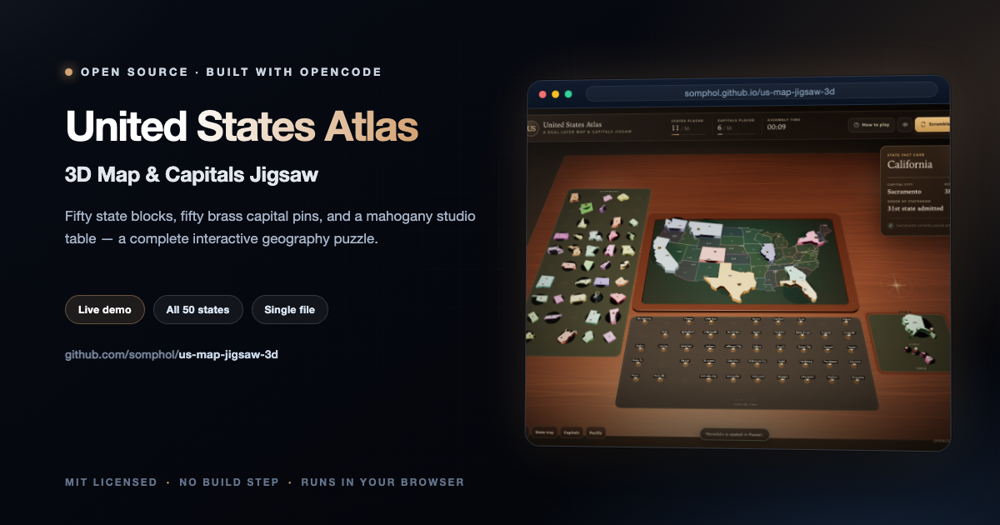
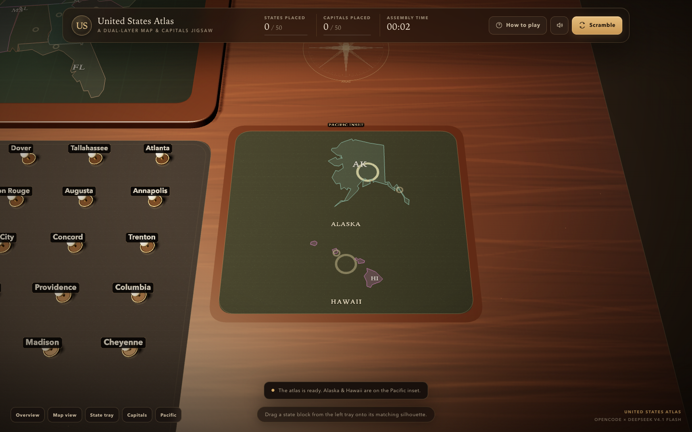
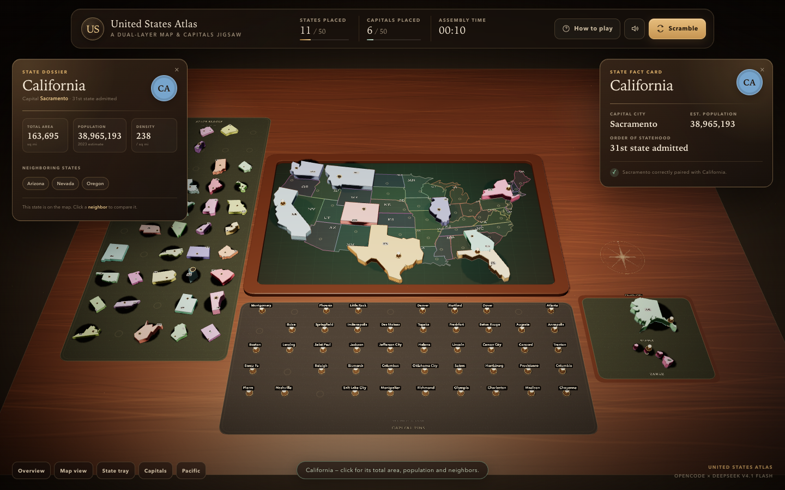
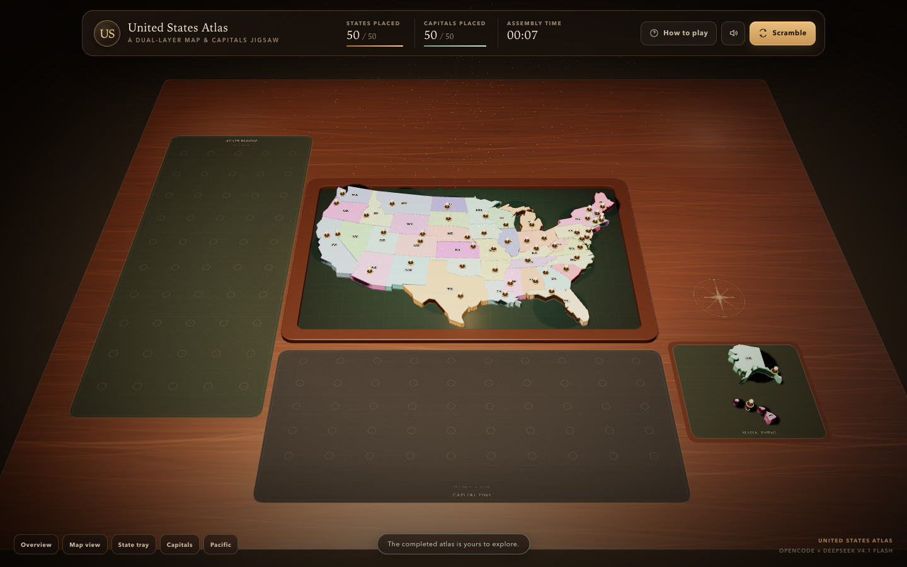
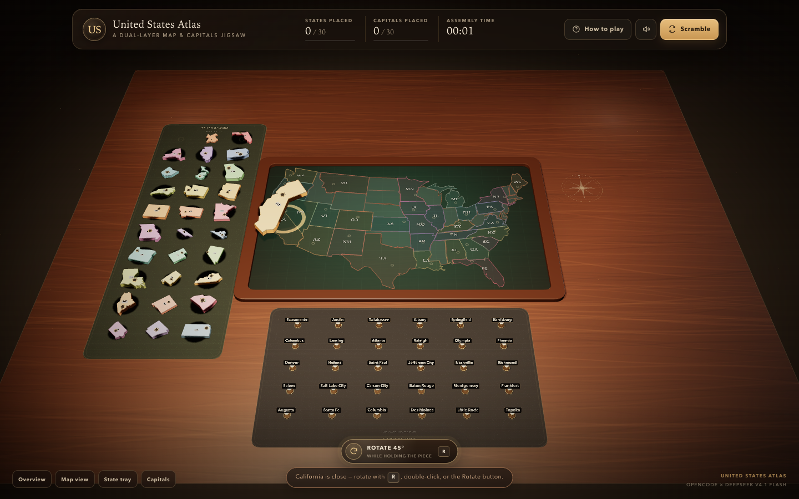

<div align="center">



# United States Atlas

**3D Map & Capitals Jigsaw**

Fifty state blocks, fifty brass capital pins, and a mahogany studio table — a complete interactive geography puzzle.

[](https://somphol.github.io/us-map-jigsaw-3d/)
[](LICENSE)

**[Try it live →](https://somphol.github.io/us-map-jigsaw-3d/)**

</div>

---

## Play

Open `index.html` in a modern desktop browser, or serve the folder locally:

```sh
cd us-map-jigsaw-3d
python3 -m http.server 8000
```

Then visit <http://localhost:8000>.

Three.js is loaded from jsDelivr, so the first load needs an internet connection. Everything else — geometry, styling, game logic, audio, and educational data — is embedded in `index.html`.

## How to play

1. **Seat the states.** Drag a colored state block from the left tray onto its faint silhouette on the map. Get close and release; it drops into place with a spring animation.
2. **Turn it true north.** Some blocks begin askew. While dragging, press `R`, double-click, or use the floating **Rotate 45°** button. A misaligned block will not snap.
3. **Crown the capitals.** Drag a capital pin from the bottom tray onto a state that is already placed. The correct pairing clicks into the socket; a wrong pairing buzzes, flashes red, shakes, and returns the pin.

When a state and its capital are both placed, a fact card appears with the capital, estimated population, and order of statehood.

4. **Inspect the states.** Click any placed state (or a capital pin) to open its state dossier: total area, population, population density, and clickable neighboring states. Alaska and Hawaii have labeled drop zones on the Pacific inset plaque. Use the **Pacific** view button for a closer look.

## Controls

| Input | Action |
| --- | --- |
| Left-drag empty table | Orbit the camera |
| Right-drag / two-finger drag | Pan the table |
| Mouse wheel / pinch | Zoom |
| Drag a state or pin | Move it across the table |
| `R`, double-click, or **Rotate 45°** | Rotate the held state block 45° |
| `Esc` | Return the held piece to its tray |
| `M` | Mute / unmute synthesized audio |
| `H` | Open the rules |
| Click a placed state or capital pin | Open its state dossier |
| Overview / Map / State tray / Capitals / Pacific | Fly the camera to a useful view |
| Scramble | Reset the board and timer |

On touch screens, use the same drag-and-drop gestures; the view buttons along the bottom left jump between the map and the two trays.

## Features

- **Dual-layer jigsaw** — all 50 extruded state blocks with capital sockets, plus 50 individually labeled brass capital pins.
- **Sculpted tabletop scene** — procedurally generated mahogany, felt inlays, a semi-transparent recessed map plate, engraved labels, compass rose, soft shadows, dust motes, and a warm studio spotlight.
- **All 50 states on the board** — the 48 contiguous states share the main recessed baseplate, while Alaska and Hawaii sit on a separate Pacific inset plaque, so the finished atlas is complete.
- **Raycast drag-and-drop** — generous invisible pick targets, smooth lift, snap highlighting, and spring drop animations.
- **Discoverable rotation** — a floating **Rotate 45°** control appears while dragging, alongside `R` and double-click rotation, with an orange “rotate to align” halo when a piece is close but twisted.
- **Dual-snap validation** — state blocks must align both position and rotation; capital pins validate against the state beneath them, not just a socket radius.
- **Rejection feedback** — buzz, red screen flash, socket flash, and a shake animation for wrong capital pairings.
- **Web Audio synthesis** — mechanical clicks, wooden snaps, a low buzz, success chimes, and a victory fanfare, all generated at runtime with no audio files.
- **Glass HUD** — live state/capital counters, progress meters, assembly timer, sound toggle, and scramble/reset.
- **Educational fact cards** — capital city, estimated population, and statehood order for every completed pairing.
- **State dossier on click** — total area, population, density, and neighboring states for any placed state; neighbor chips are clickable, and the capital socket is offset from the state abbreviation so it never masks the name.
- **Clearly marked Pacific inset** — pulsing gold drop rings, full ALASKA/HAWAII labels, a PACIFIC INSET plaque, a dedicated camera view, and a start-up hint make the two inset states easy to find.
- **Victory sequence** — a 360° camera orbit around the glowing assembled map, golden particles, a warm map glow, and a results card with assembly time.
- **Responsive** — desktop-first layout with a portrait camera fit and touch-friendly view controls.
- **Full fifty-state finish** — every state and every capital, including the Alaska and Hawaii insets, assembled on one tabletop.

## The playable states

<details open>
<summary>All 50 states and their capitals</summary>

| State | Capital | State | Capital |
| --- | --- | --- | --- |
| Alabama | Montgomery | Alaska | Juneau |
| Arizona | Phoenix | Arkansas | Little Rock |
| California | Sacramento | Colorado | Denver |
| Connecticut | Hartford | Delaware | Dover |
| Florida | Tallahassee | Georgia | Atlanta |
| Hawaii | Honolulu | Idaho | Boise |
| Illinois | Springfield | Indiana | Indianapolis |
| Iowa | Des Moines | Kansas | Topeka |
| Kentucky | Frankfort | Louisiana | Baton Rouge |
| Maine | Augusta | Maryland | Annapolis |
| Massachusetts | Boston | Michigan | Lansing |
| Minnesota | Saint Paul | Mississippi | Jackson |
| Missouri | Jefferson City | Montana | Helena |
| Nebraska | Lincoln | Nevada | Carson City |
| New Hampshire | Concord | New Jersey | Trenton |
| New Mexico | Santa Fe | New York | Albany |
| North Carolina | Raleigh | North Dakota | Bismarck |
| Ohio | Columbus | Oklahoma | Oklahoma City |
| Oregon | Salem | Pennsylvania | Harrisburg |
| Rhode Island | Providence | South Carolina | Columbia |
| South Dakota | Pierre | Tennessee | Nashville |
| Texas | Austin | Utah | Salt Lake City |
| Vermont | Montpelier | Virginia | Richmond |
| Washington | Olympia | West Virginia | Charleston |
| Wisconsin | Madison | Wyoming | Cheyenne |

</details>

Alaska and Hawaii are seated on the small Pacific inset plaque to the right of the main map; the other 48 states fill the contiguous baseplate.

### The Pacific inset



### State dossier

Click any placed state to inspect its total area, population, density, and neighbors. Neighboring-state chips open the same dossier for another state.





## Project structure

```
index.html                    # the complete game; open this file
assets/mapdata.js             # projected/simplified state geometry (build artifact)
tools/generate_map_data.py    # regenerates assets/mapdata.js from public-domain boundaries
screenshot.png                # gameplay
screenshot-menu.png           # title / rules screen
screenshot-rotate.png         # rotate control while dragging
screenshot-info.png           # click-to-inspect state dossier
screenshot-inset.png          # Alaska/Hawaii drop zones
screenshot-complete.png       # all fifty states assembled
screenshot-victory.png        # victory sequence
STATE.md                      # build telemetry: time and tokens
state.json                    # machine-readable build telemetry
LICENSE                       # MIT
```



The map geometry in `assets/mapdata.js` is embedded directly into `index.html` at build time. It is not fetched at runtime. To regenerate it:

```sh
python3 tools/generate_map_data.py
python3 tools/build.py
```

(The one-file build means the repository deliberately keeps the generated map data in both places.)

## Technical notes

- **Engine:** Three.js r160 via ES-module CDN and `OrbitControls`.
- **Geometry:** US Census-derived state boundaries. The 48 contiguous states use an Albers conic projection, normalized to game units and simplified with Douglas–Peucker; Alaska and Hawaii use local inset projections on the Pacific plaque. States with multiple landmasses (for example Michigan and Hawaii) keep their significant islands.
- **Rendering:** PCF soft shadows, ACES filmic tone mapping, procedural canvas textures, additive particles, and `MeshStandardMaterial`/`MeshPhysicalMaterial` throughout.
- **Interaction:** a single `Raycaster`, invisible per-polygon pick proxies, a horizontal drag plane, tag-based tween manager, and state-machine flags for dock / dragging / placing / placed / returning.
- **Validation:** orientation-aware state snapping, point-in-polygon capital validation against placed state geometry, and a label planner that offsets each state abbreviation away from its capital socket.
- **State dossier:** area and neighbor metadata are part of the generated map data, so the click inspector remains fully self-contained.
- **Audio:** no assets; oscillators, filtered noise, and scheduled envelopes through the Web Audio API.

## Credits

Built in a single agent session with [OpenCode](https://opencode.ai) and **DeepSeek V4.1 Flash** (`opencode-go/deepseek-v4.1-flash`).

- State boundary data: [PublicaMundi US states GeoJSON](https://github.com/PublicaMundi/MappingAPI), public-domain boundaries derived from the US Census Bureau.
- Population figures: approximate 2023 US Census Bureau estimates.
- Statehood order: standard historical admission dates.
- Three.js by mrdoob and contributors.

See [STATE.md](STATE.md) for the build duration and token usage.

## License

MIT © 2026 Somphol Boonjing. See [LICENSE](LICENSE).
