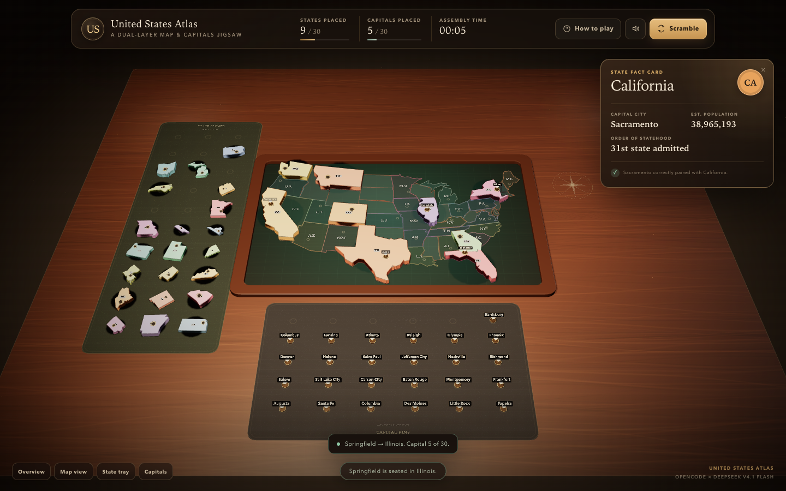

# United States Atlas

A complete, interactive **3D United States Map & Capitals jigsaw** in **one self-contained HTML file**. Thirty signature state blocks are scattered across a mahogany studio table; drag them onto their silhouettes, turn them true north, then crown each state with its brass capital pin.



**Live demo:** <https://somphol.github.io/us-map-jigsaw-3d/>

## Play

Open `index.html` in a modern desktop browser, or serve the folder locally:

```sh
cd us-map-jigsaw-3d
python3 -m http.server 8000
```

Then visit <http://localhost:8000>.

Three.js is loaded from jsDelivr, so the first load needs an internet connection. Everything else — geometry, styling, game logic, audio, and educational data — is embedded in `index.html`.

## How to play

1. **Seat the states.** Drag a colored state block from the left tray onto its faint silhouette on the map. Get close and release; it drops into place with a spring animation.
2. **Turn it true north.** Some blocks begin askew. Press `R` or double-click while dragging to rotate in 45° steps. A misaligned block will not snap.
3. **Crown the capitals.** Drag a capital pin from the bottom tray onto a state that is already placed. The correct pairing clicks into the socket; a wrong pairing buzzes, flashes red, shakes, and returns the pin.

When a state and its capital are both placed, a fact card appears with the capital, estimated population, and order of statehood.

## Controls

| Input | Action |
| --- | --- |
| Left-drag empty table | Orbit the camera |
| Right-drag / two-finger drag | Pan the table |
| Mouse wheel / pinch | Zoom |
| Drag a state or pin | Move it across the table |
| `R` or double-click | Rotate the held state block 45° |
| `Esc` | Return the held piece to its tray |
| `M` | Mute / unmute synthesized audio |
| `H` | Open the rules |
| Overview / Map / State tray / Capitals | Fly the camera to a useful view |
| Scramble | Reset the board and timer |

On touch screens, use the same drag-and-drop gestures; the view buttons along the bottom left jump between the map and the two trays.

## Features

- **Dual-layer jigsaw** — 30 extruded state blocks with capital sockets, plus 30 individually labeled brass capital pins.
- **Sculpted tabletop scene** — procedurally generated mahogany, felt inlays, a semi-transparent recessed map plate, engraved labels, compass rose, soft shadows, dust motes, and a warm studio spotlight.
- **All 48 contiguous states on the board** — the eighteen states outside the playable set are rendered as muted inlays, so the finished map reads as a whole country.
- **Raycast drag-and-drop** — generous invisible pick targets, smooth lift, snap highlighting, and spring drop animations.
- **Dual-snap validation** — state blocks must align both position and rotation; capital pins validate against the state beneath them, not just a socket radius.
- **Rejection feedback** — buzz, red screen flash, socket flash, and a shake animation for wrong capital pairings.
- **Web Audio synthesis** — mechanical clicks, wooden snaps, a low buzz, success chimes, and a victory fanfare, all generated at runtime with no audio files.
- **Glass HUD** — live state/capital counters, progress meters, assembly timer, sound toggle, and scramble/reset.
- **Educational fact cards** — capital city, estimated population, and statehood order for every completed pairing.
- **Victory sequence** — a 360° camera orbit around the glowing assembled map, golden particles, a warm map glow, and a results card with assembly time.
- **Responsive** — desktop-first layout with a portrait camera fit and touch-friendly view controls.

## The playable states

<details>
<summary>30 states and their capitals</summary>

| State | Capital | State | Capital |
| --- | --- | --- | --- |
| California | Sacramento | Texas | Austin |
| Florida | Tallahassee | New York | Albany |
| Illinois | Springfield | Pennsylvania | Harrisburg |
| Ohio | Columbus | Michigan | Lansing |
| Georgia | Atlanta | North Carolina | Raleigh |
| Washington | Olympia | Arizona | Phoenix |
| Colorado | Denver | Montana | Helena |
| Minnesota | Saint Paul | Missouri | Jefferson City |
| Tennessee | Nashville | Virginia | Richmond |
| Oregon | Salem | Utah | Salt Lake City |
| Nevada | Carson City | Louisiana | Baton Rouge |
| Alabama | Montgomery | Kentucky | Frankfort |
| Maine | Augusta | New Mexico | Santa Fe |
| South Carolina | Columbia | Iowa | Des Moines |
| Arkansas | Little Rock | Kansas | Topeka |

</details>

## Project structure

```
index.html                    # the complete game; open this file
assets/mapdata.js             # projected/simplified state geometry (build artifact)
tools/generate_map_data.py    # regenerates assets/mapdata.js from public-domain boundaries
screenshot.png                # gameplay
screenshot-menu.png           # title / rules screen
screenshot-victory.png        # victory sequence
STATE.md                      # build telemetry: time and tokens
state.json                    # machine-readable build telemetry
LICENSE                       # MIT
```

The map geometry in `assets/mapdata.js` is embedded directly into `index.html` at build time. It is not fetched at runtime. To regenerate it:

```sh
python3 tools/generate_map_data.py
python3 tools/build.py
```

(The one-file build means the repository deliberately keeps the generated map data in both places.)

## Technical notes

- **Engine:** Three.js r160 via ES-module CDN and `OrbitControls`.
- **Geometry:** US Census-derived state boundaries, projected with an Albers conic projection, normalized to game units, and simplified with Douglas–Peucker. States with multiple landmasses (for example Michigan) keep their largest polygons.
- **Rendering:** PCF soft shadows, ACES filmic tone mapping, procedural canvas textures, additive particles, and `MeshStandardMaterial`/`MeshPhysicalMaterial` throughout.
- **Interaction:** a single `Raycaster`, invisible per-polygon pick proxies, a horizontal drag plane, tag-based tween manager, and state-machine flags for dock / dragging / placing / placed / returning.
- **Validation:** orientation-aware state snapping and point-in-polygon capital validation against placed state geometry.
- **Audio:** no assets; oscillators, filtered noise, and scheduled envelopes through the Web Audio API.

## Credits

Built in a single agent session with [OpenCode](https://opencode.ai) and **DeepSeek V4.1 Flash** (`opencode-go/deepseek-v4.1-flash`).

- State boundary data: [PublicaMundi US states GeoJSON](https://github.com/PublicaMundi/MappingAPI), public-domain boundaries derived from the US Census Bureau.
- Population figures: approximate 2023 US Census Bureau estimates.
- Statehood order: standard historical admission dates.
- Three.js by mrdoob and contributors.

See [STATE.md](STATE.md) for the build duration and token usage.

## License

MIT © 2026 Somphol Boonjing. See [LICENSE](LICENSE).
